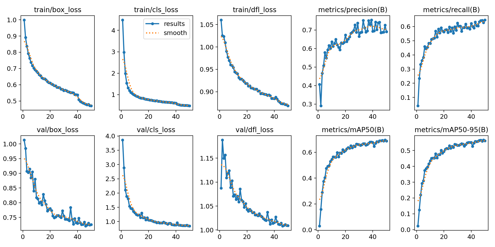

# Shelf product detection, Hackology II solo redo

Object detection on photos of store shelves. There are 369 classes and each class is one specific product. The metric is mAP@0.5 and the annotations use the COCO format.

This repository is my solo redo of the Hackology II hackathon task, which ran on 23 and 24 May 2026. I am doing it again alone so that I can explain every step. The plan was a budget of 24 hours of net work. I stopped timing during the experiments and most likely went over it. The score matters less than understanding where it comes from.

## Results

The best run is B with mAP@0.5 of 0.655. B30 scores 0.648 in 57% of B's training time, so it is the base for further runs. Both numbers are measured on 300 real photos held out from training, using my own validation split. They are local numbers, not leaderboard scores. The hackathon leaderboard no longer accepts submissions.

One experiment is one change. Every row is scored on the same 300 validation photos.

| ID | What changed | Optimizer steps | mAP@0.5 | Ultralytics mAP50 | Training time |
|---|---|---|---|---|---|
| A | Baseline. Real photos only, YOLOv8n, image size 640, 50 epochs, Ultralytics defaults | 2600 | 0.024 | 0.0258 | 58 min, Mac |
| A2 | A with the optimizer set explicitly to AdamW, `lr0=0.001` | 2600 | 0.455 | 0.4987 | 64 min, Mac |
| K640 | Control, not an experiment. A2 repeated on Kaggle with no setting changed | 2600 | 0.450 | 0.4831 | 12 min, Kaggle |
| A3 | K640 with image size 960 | 2600 | 0.530 | 0.5620 | 26 min, Kaggle |
| B | A3 plus the 2781 synthetic images | 11300 | 0.655 | 0.6873 | 1 h 52 min, Kaggle |
| B30 | B with 30 epochs instead of 50 | 6780 | 0.648 | 0.6676 | 1 h 04 min, Kaggle |
| A3-130 | A3 with 130 epochs instead of 50 | 6760 | 0.629 | 0.6696 | 1 h 08 min, Kaggle |
| C | Pretrain on synthetic images, fine-tune on real photos | | not run | | |

mAP@0.5 is my number from `evaluate_map.py` and the only one I compare runs by. The Ultralytics column is a cross-check, see [How the score is computed](#how-the-score-is-computed). Differences below about 0.01 are noise, see [Limitations](#limitations). [`RESULTS.md`](RESULTS.md) has the full numbers and conclusions per run, [`OBSERVATIONS.md`](OBSERVATIONS.md) the evidence and open questions.

### What each run showed

- **A.** Undertrained. With `optimizer=auto` Ultralytics ignored `lr0=0.01` and picked AdamW with a learning rate of 2.7e-05, about 370 times smaller. AP@0.75 (0.022) was close to AP@0.5, so boxes were placed well and classification was the weak part.
- **A2.** One change gave a score about 19 times higher, so the learning rate was the bottleneck.
- **K640.** The difference to A2 is -0.005, below the noise level. Moving to Kaggle changes the time, not the score, so later Kaggle runs are compared with K640.
- **A3.** At 640 a bottle is about 24 pixels wide and its label is hard to read. Image size 960 gave +0.080 over K640, and the class loss fell the most. This fits the idea that labels became readable, without proving it.
- **B.** +0.125 over A3, but each epoch also had 4.4 times more optimizer steps, so the gain mixed two causes.
- **B30 and A3-130.** These two separate the causes. Both make about 6,800 optimizer steps, B30 with the synthetic images and A3-130 without. Training A3 longer gave +0.099, so A3 was undertrained. The synthetic images gave +0.019 at the same number of steps. B30 is 0.007 below B, within the noise.



The figure is `results.png` as Ultralytics wrote it for B. Its mAP50 is the Ultralytics number. The dip at epoch 41 is mosaic augmentation switching off for the last 10 epochs.

### Not done yet

C has no result. An error analysis per class is in progress. It should show which classes score near zero, and whether they are the ones with few real photos.

## Task and data

- The training set has 3904 images. 1123 are real photos and 2781 are synthetic renders.
- Each image has a `source_dataset` field in `annotations.json`. The values `SIDG_TRAIN` and `SIDG_SYNTH_TRAIN` mark synthetic images.
- The test set contains real photos only and has no annotations.
- Only products from the 369 classes have boxes. Other products on the same shelf have none, so the model learns them as background.

The data is not in this repository. It comes from the organizers and the rules for publishing it are not confirmed. [`taxonomy.json`](taxonomy.json) and [`test_images.json`](test_images.json) are the organizers' files.

## Method

### Validation split

I took 300 of the 1123 real photos as the validation set, with `random.seed(2)`. The ids are frozen in [`splits/val_image_ids.json`](splits/val_image_ids.json), which is tracked in git. The other 823 real photos are the real part of the training set in every run.

The split is frozen because a score only means something next to another score on the same photos. Changing the split invalidates every row in the results table. Validation uses real photos only because the test set is real photos only.

The 300 validation photos carry 4097 ground-truth boxes.

### Pipeline

1. [`scripts/validation/data_split.py`](scripts/validation/data_split.py) samples the 300 validation ids and saves them.
2. [`scripts/evaluation/build_val_ground_truth.py`](scripts/evaluation/build_val_ground_truth.py) cuts the COCO annotations down to those 300 photos and writes the ground truth for evaluation.
3. [`scripts/training/convert_coco_to_yolo.py`](scripts/training/convert_coco_to_yolo.py) writes the train and validation image lists and one YOLO label file per photo. COCO boxes are `[x, y, width, height]` in pixels from the top-left corner. YOLO wants the box center and size as fractions of the image size. COCO class ids run from 1 to 369 and YOLO indices from 0 to 368, so the script subtracts 1. Validation photos are excluded from the training list. A constant `training_data` at the top of the script picks the training photos: `"real"` gives the 823 real photos and `"synth"` adds the 2781 synthetic renders, 3604 in total.
4. [`scripts/training/make_dataset_yaml.py`](scripts/training/make_dataset_yaml.py) writes the dataset config that Ultralytics reads.
5. [`scripts/training/train.py`](scripts/training/train.py) fine-tunes the model on the Mac. The Kaggle runs make the same `model.train` call from a notebook in [`notebooks/training/`](notebooks/training/), with `device=0`.
6. [`scripts/validation/predict_val.py`](scripts/validation/predict_val.py) loads `best.pt` from the run folder, predicts on the 300 validation photos at the image size used in training and converts the output back to COCO format. It adds 1 to the class index and turns corner coordinates into `[x, y, width, height]`.
7. [`scripts/evaluate_map.py`](scripts/evaluate_map.py) scores the predictions against the ground truth with `pycocotools`.

### Training setup

| Setting | Value |
|---|---|
| Model | YOLOv8n, pretrained weights `yolov8n.pt` |
| Library | Ultralytics 8.4.51 |
| Batch size | 16, with `cache="ram"` |
| Optimizer | AdamW with `lr0=0.001` from A2 on. A used `optimizer=auto`, which resolved to AdamW with learning rate 2.7e-05 |
| Image size | 640 for A, A2 and K640, 960 from A3 on |
| Training photos | 823 real. B and B30 add the 2781 synthetic renders, 3604 in total |
| Epochs | 50, except B30 (30) and A3-130 (130) |
| Hardware | A and A2 on a Mac M4 with 24 GB RAM, `device="mps"`, Python 3.14. The other runs on a Kaggle Tesla T4, `device=0`, Python 3.13.15, PyTorch 2.11.0 with CUDA |

### How the score is computed

`predict_val.py` runs the model with a confidence threshold of 0.001. mAP is computed from the whole ranking of detections, so the low-confidence boxes are needed too.

`evaluate_map.py` runs `COCOeval` from `pycocotools`. The number I report is the AP at IoU 0.50 from its summary. Every run is scored this way on the Mac, the ones trained on Kaggle too. Scoring the same weights twice gave identical numbers, so the scoring adds no noise of its own.

Ultralytics prints its own mAP50 during validation. My number is lower by 2.9% to 8.8%, and the gap is not constant, so one cannot be converted into the other. Up to B the two agreed on the differences between runs, for example B minus A3 is +0.125 in both. A3-130 against B30 is the first pair where they disagree on the order: mine puts B30 0.019 higher, Ultralytics 0.002 lower. I use my number because it scores one class per box, the way a submission would. The likely cause of the gap is under [Problems observed](#problems-observed).

## Problems observed

The full log with evidence is in [`OBSERVATIONS.md`](OBSERVATIONS.md). The ones worth knowing:

- **Learning rate chosen automatically.** See run A under [Results](#results). Status: measured and confirmed by run A2.
- **Slow first epoch.** About 6.3 seconds per batch of 16. Ultralytics uses 0 dataloader workers on MPS, so one thread decoded 12-megapixel JPEGs and built mosaics. With `cache="ram"` a batch takes about 0.8 to 1 second. Status: resolved.
- **Memory pressure on the Mac.** During run A the training process held about 20.7 GB of 24 GB and swap was about 8.3 GB. Image size 960 at batch 16 does not fit comfortably, so A3 ran on Kaggle. Status: measured.
- **Duplicate ground-truth boxes.** 94 of the 4097 validation boxes are exact duplicates. Ultralytics drops them and `pycocotools` keeps them. Status: measured.
- **Two evaluators, two numbers.** `evaluate_map.py` is lower than the Ultralytics mAP50 by 2.9% to 8.8%, depending on the run. From the source code of both libraries, the likely main cause is that Ultralytics validation keeps every class above the confidence threshold for each box (`multi_label=True`), while `predict_val.py` keeps only the best class per box. The duplicate ground-truth boxes and a different interpolation of the precision-recall curve may add to it. The COCO limit of 100 detections applies per image and per class, so it does not bind here. Status: hypothesis from reading the code, not tested.
- **The scoring script overwrites its output.** `predict_val.py` writes `splits/val_predictions.json` on every call and prints the box count without the weights or the image size. A pasted log does not say which run it belongs to, so I scored one run at a time and wrote the number down before the next. Status: open.
- **Zero predictions from a smoke model.** After 3 epochs on 10% of the data, `predict_val.py` returned 0 boxes at confidence 0.001. Status: hypothesis.
- **Pipeline check with the pretrained model.** `yolov8n.pt` without fine-tuning gave 89515 boxes for the 300 photos and mAP 0.000, as expected, because COCO classes do not match the 369 products. That proved the file format. The coordinates and the class shift were confirmed later, when run A gave a non-zero score close to the Ultralytics one.
- **Python version.** `pyproject.toml` allows Python 3.11 and newer. `build_val_ground_truth.py` uses an f-string with nested double quotes, which works on 3.12 and newer only. My environment runs 3.14. Status: open, minor.

## Limitations

- **Local validation only.** The only number is mAP@0.5 on my own split. The original team's leaderboard score of about 0.6 is from memory and unverified, so I do not use it as a baseline.
- **One run per variant.** No run was repeated, so the spread between runs is unknown. I treat differences below about 0.01 as noise.
- **Validation covers about 237 of 369 classes.** 10 classes appear only in validation. 45 appear only in real training photos and are not evaluated. Many classes have 1 or 2 validation boxes, so their AP is noisy.
- **17 classes have no training boxes at all.** About 70 appear only on synthetic images.
- **Duplicates lower the ceiling.** A model returns one box per object, so with duplicate ground truth the achievable mAP is slightly below 1.
- **Unlabeled products.** A detection on a product outside the 369 classes counts as a false positive. This matches how the test set is scored, but it limits precision.
- **Synthetic images are renders, not photos.** Their effect is measured on real validation photos, with one run per variant.
- **The leak check covers image paths only.** No photo is in both the training and the validation list, but a render of the same shelf as a validation photo, or a duplicate under another file name, would not show up.
- **Few experiments.** This is a solo redo planned for 24 hours of net work. There is no extensive hyperparameter search.

[`LIMITATIONS.md`](LIMITATIONS.md) has the longer version.

## How to reproduce

You need the dataset under `data/train/`. It is not part of this repository.

```bash
uv sync
```

Run the scripts from the repository root, in this order:

```bash
uv run python scripts/evaluation/build_val_ground_truth.py
uv run python scripts/training/convert_coco_to_yolo.py
uv run python scripts/training/make_dataset_yaml.py
uv run python scripts/training/train.py
uv run python scripts/validation/predict_val.py
uv run python scripts/evaluate_map.py
```

- [`splits/val_image_ids.json`](splits/val_image_ids.json) is already in the repository. Do not run `data_split.py` again unless you mean to change the split.
- `train.py` uses `device="mps"`. Change it on other hardware. The run name and the settings are constants at the top of the file.
- `predict_val.py` has the path to the weights and the image size as constants. Point it at the run you want to score and set the image size used in training.
- `evaluate_map.py` prints the COCO summary. The second line is the AP at IoU 0.50.
- `convert_coco_to_yolo.py` has a constant `training_data` at the top. Set it to `"real"` to reproduce runs A to A3 and A3-130, and to `"synth"` for runs B and B30.

### Runs on Kaggle

K640, A3, B, B30 and A3-130 were trained on Kaggle. The notebooks of K640 and A3 are in [`notebooks/training/`](notebooks/training/). A notebook clones this repository, copies the images from a private Kaggle dataset, runs the same two preparation scripts and calls `model.train` with the A2 settings and `device=0`. Those two differ only in `NAME` and `IMGSZ`, and their cell outputs hold the full training logs. B used the same notebook with another `NAME`, a clone of the branch that has the `training_data` switch, and 3904 labels expected in the second check. B30 and A3-130 changed the number of epochs as well. A3-130 cloned a branch with the switch set to `"real"` and expected 1123 labels.

The dataset is private, so the notebooks will not run for anyone else as they are. I downloaded `best.pt` from the notebook output and scored it on the Mac with `predict_val.py` and `evaluate_map.py`.

### Helper scripts

Four helper scripts are not part of the main path. [`scripts/evaluation/make_perfect_predictions.py`](scripts/evaluation/make_perfect_predictions.py) builds predictions from the ground truth, to see what the evaluator prints for a perfect answer. [`scripts/training/draw_labels.py`](scripts/training/draw_labels.py) draws the YOLO labels of one photo to check the conversion. [`scripts/validation/val_image_ids.py`](scripts/validation/val_image_ids.py) prints how many classes appear in each part of the split. [`scripts/validation/training_and_val_data_check.py`](scripts/validation/training_and_val_data_check.py) prints how many photos are in both the training list and the validation list, which must be 0.

## Repository layout

```
RESULTS.md               results table, source of truth for scores
OBSERVATIONS.md          log of problems with evidence and status
LIMITATIONS.md           limits of the measurement and the data
scripts/validation/      validation split, class coverage check, prediction on validation, train and validation list check
scripts/training/        label conversion, dataset config, training
scripts/evaluation/      ground truth for the validation photos, perfect-answer check
scripts/evaluate_map.py  mAP with pycocotools
splits/val_image_ids.json  the frozen 300 validation ids
predict.py               organizers' prediction CLI, see below
notebooks/               notebooks from the organizers' template
notebooks/training/      Kaggle notebooks for runs K640 and A3, with training logs
assets/a3-results.png    training curves of run A3, written by Ultralytics
assets/b-results.png     training curves of run B, written by Ultralytics
taxonomy.json, test_images.json, download_data.sh, checksums.sha256   organizers' files
docs/organizers/README.md  original hackathon README, in Polish
ONBOARDING.md            organizers' onboarding guide, in Polish
```

[`predict.py`](predict.py) is the command line interface the organizers required. It is still their baseline. By default it loads the COCO-pretrained `yolov8n.pt` and is not yet connected to the weights trained here.

## Origin and license

The repository started as the organizers' template for Hackology II. Their original instructions are in [`docs/organizers/README.md`](docs/organizers/README.md) and [`ONBOARDING.md`](ONBOARDING.md).

The code is under the GNU Affero General Public License v3, see [`LICENSE`](LICENSE). The license does not cover the organizers' data files.
